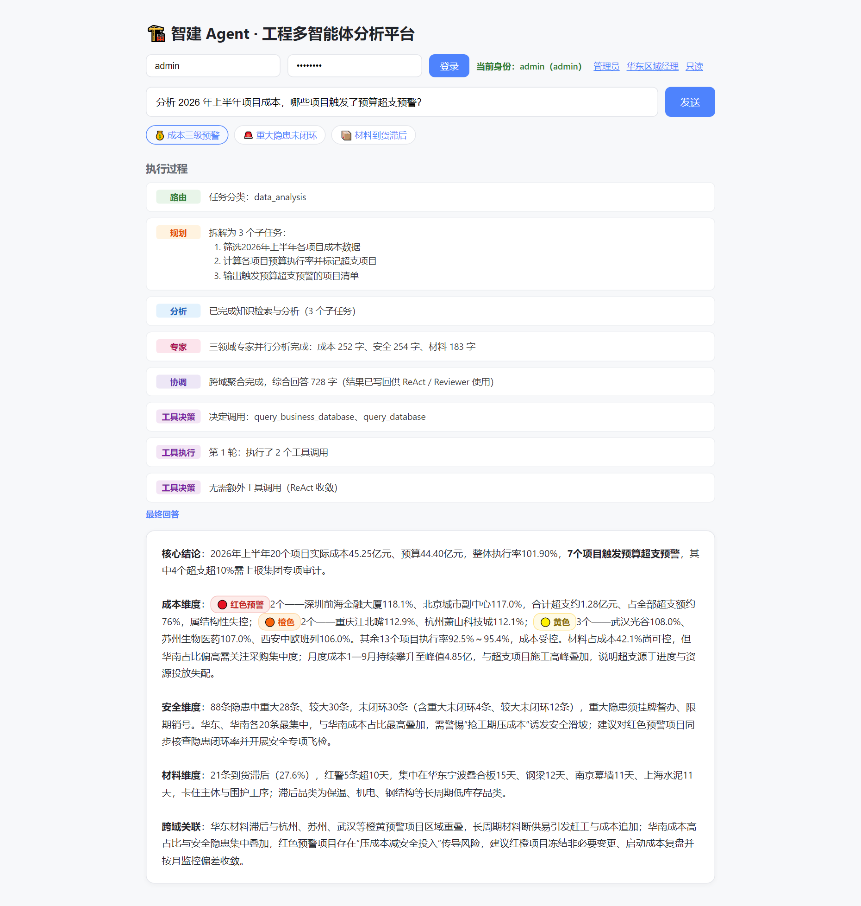

# 🏗️ 智建 Agent · 工程多智能体分析平台

[](https://github.com/liushaolong111/multi-agent-platform)

> 基于 **LangGraph + RAG + 双层记忆 + MCP 工具总线** 构建的工程多智能体协作平台「智建 Agent」

用户输入任务后，系统自动分类、拆解、检索工程管理制度与项目数据、调用工具（Text-to-SQL / 成本统计 / 安全统计）、分析、审核，最终给出**可溯源**的回答。

> **说明**：本项目是个人作品，业务原型取自工程项目管理（成本、质量安全、区域公司权限）的真实痛点，数据为模拟样本，**不代表任何企业的真实项目或线上系统**。

## ✨ 核心特性

- **ReAct 工具循环**：Router → Planner → Skill → ToolDecide ⇄ ToolExec → Reviewer。模型看到工具执行结果（Observation）后再决定下一轮，支持多步探索；达到轮数上限（`MAX_TOOL_ROUNDS`）自动熔断，防止无限循环
- **人工审批闸门（HITL）**：高危工具（查业务库）执行前经 LangGraph `interrupt()` 挂起，**人工批准才放行**，断点由 checkpointer 持久化，`POST /chat/approve` 从断点恢复
- **JWT 认证 + RBAC 行级隔离**：登录签发 token（HS256），`admin / manager / viewer` 三角色；区域经理只能看本区域数据，权限作为**贯穿所有数据出口的不变量**（SQL / 预计算统计 / 知识检索 / 工具 / 图表共用同一判定）
- **Text-to-SQL 真查库**：查询业务库由 LLM 生成 SQL——三层只读防护 + 执行前静态越权校验 + 报错自愈重试，能答的问题集合 = 整个 schema 能表达的所有查询
- **RAG 检索增强**：FAISS / Qdrant 双后端（工厂模式，Qdrant 不可达自动降级 FAISS），bge-small-zh 本地向量化，检索按 metadata 过滤
- **双层记忆**：Redis 短期记忆（会话上下文）+ SQLAlchemy 长期记忆（PostgreSQL/SQLite 可配置，跨会话历史）
- **原生 Function Calling**：工具决策走 DeepSeek `bind_tools`，结构化决策，免除 prompt 拼 JSON 再解析
- **MCP 工具总线**：`app/mcp/server.py` 用官方 MCP SDK 暴露 7 个工具（SQL 查询 / 材料查询 / 向量检索 / ERP 采购单 / 库存 / 进度 / schema），`client.py` 把它们桥接成 LangChain 工具挂进 Agent——工具实现可独立部署、被任意 MCP 客户端复用，`ENABLE_MCP_TOOLS=true` 一键开启
- **结构化日志**：structlog + contextvars——请求入口绑定 `request_id / session_id / user_id`，整条链路（含第三方库）日志自动携带，`LOG_FORMAT=json` 可被日志系统直接采集
- **LLM 全链路异步化**：Skill 的多子任务 `asyncio.gather` 并发，延迟从 N×T 降到 ≈1×T
- **可量化效果 + CI 门禁**：20 题评测集（关键词评分 + LLM-as-judge），评估脚本支持 `--gate`，正确率低于阈值直接让 CI 失败
- **可观测性**：LangSmith 链路追踪（可选）+ `/metrics` 端点实时暴露 token 用量与各节点延迟
- **流式输出**：SSE 逐节点推送，用户实时看到 AI 的思考过程
- **Docker 化部署**：`docker compose` 一条命令启动 5 服务（api / redis / postgres / qdrant + seed 初始化）
- **多维数据分析**：支持项目成本排名、区域×成本类别交叉表、月度趋势、预算执行率、质量安全问题闭环率
- **三级预警体系**：成本按项目聚合执行率（≥105% 🟡 / ≥110% 🟠 / ≥115% 🔴）、安全按严重程度与超期天数、材料按到货滞后天数三个口径统一分级；阈值集中在 `skill.py` 顶部常量，UI 自动渲染成彩色徽章

## 🏗️ 架构设计

```
                        用户输入（JWT 认证 → user_id / role / region）
                                  │
                                  ▼
                        ┌──────────────────┐
                        │      Router      │ 任务分类
                        └──────────────────┘
                                  │
                                  ▼
                        ┌──────────────────┐
                        │     Planner      │ 拆解为 3-5 个子任务
                        └──────────────────┘
                                  │
                                  ▼
          ┌────────────────────────────────────────────────┐
          │                    Skill                        │
          │  Redis 短期记忆 + RAG 检索（FAISS / Qdrant）     │
          │  + 预计算精确统计 / Text-to-SQL（按角色过滤）    │
          │  └──── asyncio.gather 并发调用 DeepSeek ────┘   │
          └────────────────────────────────────────────────┘
                                  │
                                  ▼
          ┌────────────────────────────────────────────────┐
          │  Experts：成本 / 安全 / 材料 三领域专家并行分析  │
          │  （asyncio.gather，延迟 ≈ 1×LLM）               │
          └────────────────────────────────────────────────┘
                                  │
                                  ▼
          ┌────────────────────────────────────────────────┐
          │  Coordinator：跨域聚合，消解结论冲突与重复       │
          └────────────────────────────────────────────────┘
                                  │
                                  ▼
          ┌────────────────────────────────────────────────┐
          │       ReAct 循环（最多 MAX_TOOL_ROUNDS 轮）      │
          │                                                 │
          │   ┌────────────┐  有高危调用   ┌────────────┐   │
          │   │ ToolDecide │ ────────────▶ │  Approval  │   │
          │   │ 决策调哪些 │               │ interrupt  │   │
          │   │ 工具(FC)   │ ◀──┐          │ 人工审批   │   │
          │   └────────────┘    │          └────────────┘   │
          │        │  无调用/    │                │          │
          │        │  已收敛     │ 观测回喂        ▼          │
          │        │            │          ┌────────────┐   │
          │        │            └──────────│  ToolExec  │   │
          │        │                       │ 执行 → 观测 │   │
          │        │                       └────────────┘   │
          └────────┼────────────────────────────────────────┘
                   │
                   ▼
          ┌──────────────────┐
          │    Reviewer      │ 审核（APPROVED / REVISE）
          └──────────────────┘
                   │
         ┌─────────┴─────────┐
         ▼                   ▼
  REVISE → 返回 Planner   APPROVED → 输出
  (最多循环 3 次)
```

> RBAC 体现在**每一个数据出口**：Text-to-SQL 的 SQL、预计算统计、RAG 检索的 metadata 过滤、工具返回、图表数据，
> 五处共用同一个 `scoped_region(role, region)` 判定——最弱的通道决定整体安全性。

## 🛠️ 技术栈

| 层级 | 技术选型 | 说明 |
|------|---------|------|
| 编排框架 | **LangGraph** | StateGraph 条件边 + `interrupt()` 断点 + checkpointer 持久化 |
| LLM | **DeepSeek** | OpenAI 兼容接口，中文能力强 |
| Embedding | **BAAI/bge-small-zh-v1.5** | 本地运行，零 API 成本 |
| 向量检索 | **FAISS / Qdrant** | 工厂模式双后端；Qdrant 原生 payload 过滤，不可达自动降级 FAISS |
| 短期记忆 | **Redis** | 会话状态，TTL 自动过期；不可达时降级进程内存储 |
| 长期记忆 | **SQLAlchemy** | 跨会话持久化，PostgreSQL/SQLite 通过 `DATABASE_URL` 一键切换 |
| 业务数据 | **MySQL / PostgreSQL + Text-to-SQL** | LLM 生成 SQL 查真实业务表（项目/成本/安全问题），三层只读防护 + 执行前静态越权校验 |
| 认证 / 权限 | **PyJWT + RBAC** | HS256 token；PBKDF2-HMAC-SHA256 密码哈希；三角色行级数据隔离 |
| 工具调用 | **原生 Function Calling** | DeepSeek `bind_tools`，结构化决策、免除 JSON 解析兜底 |
| 工具总线 | **MCP（Model Context Protocol）** | `app/mcp/server.py` 以 MCP Server 暴露 7 个工具；`client.py` 桥接成 LangChain StructuredTool，`ENABLE_MCP_TOOLS=true` 即挂载，工具实现与 Agent 解耦 |
| 结构化日志 | **structlog** | 与 stdlib 桥接，contextvars 全链路追踪，`LOG_FORMAT=json` 可直接采集 |
| 链路追踪 | **LangSmith**（可选） | 环境变量开启，全链路 span + token 消耗可视化 |
| 后端框架 | **FastAPI** | 异步高性能 HTTP 服务，slowapi 限流 + 可选 API Key 鉴权 |
| 流式输出 | **SSE** | Server-Sent Events 实时推送 |
| 前端 | 原生 HTML/JS | 登录身份切换 + 逐节点执行过程 + Markdown 渲染 |
| 容器化 | **Docker Compose** | 5 服务（api / redis / postgres / qdrant + seed），healthcheck 编排启动顺序 |

## 🚀 快速开始

### 前置条件

- Docker 20.10+
- Docker Compose 2.0+
- DeepSeek API Key（[申请地址](https://platform.deepseek.com)）

### 启动步骤

```bash
# 1. 克隆项目
git clone https://github.com/liushaolong111/multi-agent-platform.git
cd multi-agent-platform

# 2. 配置 API Key
echo "DEEPSEEK_API_KEY=sk-你的真实key" > .env

# 3. 启动服务（api / redis / postgres / qdrant）
docker compose up -d --build

# 4. 首次初始化：灌业务库种子数据 → 生成业务摘要 → 重建向量索引
#    （sync_business_to_rag.py 内部会调用 ingest.build_index，保证 RAG 摘要与业务库数字同源）
docker compose --profile setup up seed

# 5. 访问 Web UI
# 浏览器打开 http://localhost:8000/ui
```

### 演示账号

初始化脚本会创建三个账号，用于体验 RBAC 行级隔离（Web UI 登录栏提供一键填充）：

| 用户名 | 密码 | 角色 | 数据权限 |
|--------|------|------|---------|
| `admin` | `admin123` | 集团管理员 | 全部区域数据 |
| `manager_hd` | `manager123` | 区域经理（华东） | 仅华东区域数据 |
| `viewer` | `viewer123` | 只读 | 全部数据但只读 |

### 企业模式（可选）

默认 `AUTH_ENABLED=false`、`APPROVAL_MODE=false`，本地开发免登录。按需开启：

```bash
AUTH_ENABLED=true    # /chat、/chat/stream 需要 JWT（先 POST /auth/login 拿 token）
APPROVAL_MODE=true   # 高危工具（查业务库）执行前挂起，需 POST /chat/approve 人工放行
LOG_FORMAT=json      # 结构化日志（每行一个 JSON，含 request_id/session_id/user_id）
```

### 常用命令

```bash
docker compose up -d       # 启动
docker compose stop        # 停止（保留数据）
docker compose down        # 停止并删除容器
docker compose logs -f api # 实时查看日志
```

## 📸 效果展示

### Web UI 界面



访问 `/ui` 后，先登录（或一键选择演示账号），再输入任务，可以看到**实时的执行过程**：

```
[路由]      任务分类：data_analysis
[规划]      拆解为 2 个子任务：1. 统计 2026 上半年项目总成本  2. 找出成本最高的项目与区域
[分析]      已完成知识检索与分析（2 个子任务）
[工具决策]  决定调用：query_business_database
[人工审批]  已批准放行                ← APPROVAL_MODE=true 时出现（否则直接执行）
[工具执行]  第 1 轮：执行了 1 个工具调用
[工具决策]  无需额外工具调用（ReAct 收敛）
[审核通过]  2026 上半年总成本 4,524,731,515 元 ...
```

登录身份会决定数据可见范围：用 `manager_hd` 登录后问"各区域成本"，答案只包含**华东**；换 `admin` 登录则可见全部六大区域。

### 实际回答示例

**问**：2026 年上半年项目成本整体情况如何？哪个区域最高？

**答**：
> 2026 上半年实际成本合计 **4,524,731,515 元**，预算 **4,440,467,571 元**，整体预算执行率 **101.90%**。
>
> 成本最高的区域是**华南**（1,356,155,241 元，占比 30.0%），其中**厦门翔安新机场航站楼项目**以 572,433,499 元居各项目之首；成本类别中**材料**占比最高（42.1%）。
>
> 项目级预警：**深圳前海金融大厦（118.1%）**、**北京城市副中心（117.0%）** 已达红色预警，**重庆江北嘴（112.9%）**、**杭州萧山科技城（112.1%）** 为橙色，武汉光谷、苏州工业园区、西安国际港务区（108.0% / 107.0% / 106.0%）为黄色——7 个项目需重点关注，其余 13 个项目执行率 92.5%–95.4% 处于受控区间。

**问**：质量安全问题整改情况怎么样？最需要关注什么？

**答**：
> 共记录质量安全问题 **88 条**（安全 51 条、质量 37 条），已闭环 **58 条**，闭环率 **65.91%**。
>
> 其中**重大隐患 28 条**，仍有 **4 条未闭环**（深圳前海脚手架连墙件、重庆江北嘴钢结构焊缝探伤、武汉光谷有限空间气体检测、武汉光谷焊缝探伤），按制度要求应立即停工并 24 小时内上报区域公司；当前闭环率低于管理目标 95%，建议优先清理待整改项并按项目复盘重复问题。

### API 接口

```bash
# 1. 登录（企业模式必做）→ 拿 JWT
curl -X POST http://localhost:8000/auth/login \
  -H "Content-Type: application/json" \
  -d '{"username": "manager_hd", "password": "manager123"}'
# → {"access_token": "eyJ...", "token_type": "bearer", "user": {"user_id":"manager_hd","role":"manager","region":"华东"}}

# 2. 普通接口（一次性返回）；带 token 时身份一律以 token 为准
curl -X POST http://localhost:8000/chat \
  -H "Content-Type: application/json" \
  -H "Authorization: Bearer <token>" \
  -d '{"message": "分析 2026 年上半年项目成本", "session_id": "demo1"}'

# 3. 流式接口（SSE 实时推送）
curl -N -X POST http://localhost:8000/chat/stream \
  -H "Content-Type: application/json" \
  -H "Authorization: Bearer <token>" \
  -d '{"message": "分析 2026 年上半年项目成本", "session_id": "demo1"}'

# 4. 人工审批（APPROVAL_MODE=true 且上一请求返回 PENDING_APPROVAL 时）
curl -X POST http://localhost:8000/chat/approve \
  -H "Content-Type: application/json" \
  -H "Authorization: Bearer <token>" \
  -d '{"session_id": "demo1", "approved": true}'
```

API 文档：`http://localhost:8000/docs`

### 多轮对话演示（记忆层生效的证据）

同一个 `session_id` 连续提问，第二轮会带上第一轮的上下文：

```bash
# 第一轮
curl -X POST http://localhost:8000/chat -H "Content-Type: application/json" \
  -d '{"message": "2026 年上半年成本最高的项目是哪个？", "session_id": "demo1"}'
# → 厦门翔安新机场航站楼项目（572,433,499 元）

# 第二轮（"它"指代第一轮结论，短期记忆提供上下文）
curl -X POST http://localhost:8000/chat -H "Content-Type: application/json" \
  -d '{"message": "它属于哪个区域？", "session_id": "demo1"}'
# → 深圳前海金融大厦项目属于华南区域
```

跨会话后，长期记忆（`DATABASE_URL` 指向的 PostgreSQL/SQLite）仍会保留审核通过的问答，新会话可召回。

## 📏 效果评测

"减少幻觉"不能只是口号。`evals/` 目录提供 20 题带标准答案的评测集（覆盖项目成本分析、质量安全统计、制度知识问答三类），改动 prompt / 模型 / 检索参数前后跑一遍即可量化回归：

```bash
# 关键词评分（确定性规则，零额外成本）
python evals/run_eval.py

# 追加 LLM-as-judge 语义评分（覆盖关键词匹配不到的表述）
python evals/run_eval.py --judge

# 只跑前 5 题快速冒烟
python evals/run_eval.py --limit 5

# 回归门禁：正确率低于阈值时退出码 1（CI 门禁用）
python evals/run_eval.py --gate
```

输出示例：

```
总体正确率：18/20 = 90.0%
  - data_analysis: 9/10 = 90.0%
  - safety: 5/6 = 83.3%
  - knowledge_query: 4/4 = 100.0%
报告已保存：evals/report.json
```

> 注：评测会真实调用 LLM，需要 `DEEPSEEK_API_KEY` 和已构建的索引，因此不进主 CI 流程。CI 中的 `eval-gate` job 仅在仓库配置 `EVAL_GATE_ENABLED=true` 且提供 API Key secret 时运行——**正确率低于阈值直接失败，阻止合并**。

## 🔭 可观测性

**链路追踪（LangSmith，可选）**：在 `.env` 中配置后，每个节点的完整调用链、prompt、token 消耗自动上报到 [smith.langchain.com](https://smith.langchain.com)，无需改任何代码：

```bash
LANGSMITH_TRACING=true
LANGSMITH_API_KEY=lsv2_pt_你的key
```

**结构化日志（内置）**：`LOG_FORMAT=json` 时每行一个 JSON。请求入口绑定 `request_id`，`/chat` 再绑 `session_id` / `user_id`——该请求链路里任何角落（图节点、工具、httpx）打出的日志都自动携带这三个字段，按 `request_id` 一搜即得完整时间线：

```json
{"event": "[Auth] 用户登录成功：manager_hd（manager）", "request_id": "42dfd091054f", "logger": "api.auth", "level": "info", "timestamp": "2026-10-15T09:45:13.817667"}
```

**运行指标（内置，零依赖）**：`GET /metrics` 实时返回进程内聚合的指标快照——

```json
{
  "requests": {"total": 42, "errors": 0},
  "llm": {"calls": 168, "total_tokens": 152300, "avg_latency_ms": 1240.5, "p95_latency_ms": 2810.0},
  "tool_calls": {"query_database": 12, "draw_chart": 3},
  "nodes": {"skill": {"count": 42, "avg_ms": 3102.4, "p95_ms": 5600.1}}
}
```

线上排查路径：`/metrics` 定位慢节点 → LangSmith 看该节点具体调用链 → 结构化日志按 `request_id` 还原完整链路。

## 🔒 安全设计

**认证（JWT）**：`POST /auth/login` 校验用户名密码（PBKDF2-HMAC-SHA256，恒定时间比较防时序攻击）后签发 HS256 token，payload 携带 `sub / role / region`；`AUTH_ENABLED=true` 时 `/chat`、`/chat/stream`、`/chat/approve` 必须带 `Authorization: Bearer <token>`。**只要带了合法 token，身份一律以 token 为准——请求体里自报的 `user_id` 无法伪造身份**。

**授权（RBAC 行级隔离）**：`admin / manager / viewer` 三角色，`manager`（区域公司工程管理员）只能看本区域数据。权限不是某个功能的属性，而是**贯穿所有数据出口的不变量**，五处共用同一个 `scoped_region(role, region)` 判定：

| # | 数据出口 | 隔离手段 |
|---|---------|---------|
| 1 | Text-to-SQL | prompt 层权限硬约束 + 执行前静态越权校验（`sql_within_scope`，覆盖 projects / cost_records / safety_issues 三张表） |
| 2 | 预计算统计 | `compute_stats(region)` / `compute_safety_stats(region)` 只算本区域 |
| 3 | 知识检索 | chunk `visibility = public / company` + `rag_scope_filter` metadata 过滤（公司级同步摘要 manager 不可检索） |
| 4 | 工具调用 | `query_database` / `query_safety` / `read_file` 出口按角色判定 |
| 5 | 图表生成 | `_draw_chart(region)` 只统计本区域，标题带区域 |

**高危操作人工审批（HITL）**：`APPROVAL_MODE=true` 时，含高危工具（`query_business_database`）的调用经 `interrupt()` 挂起，`POST /chat/approve` 从断点恢复；审批端点**校验会话归属——只有发起该会话的用户能审批**，避免"知道 session_id 就能放行高危操作"。

**限流与 API Key**：`/chat`、`/chat/stream` 默认单 IP 10 次/分钟（`RATE_LIMIT_PER_MINUTE` 可调），超出返回 429；设置 `API_KEY` 后另需请求头 `X-API-Key` 匹配。

**已知风险**：用户输入会拼接进 prompt，当前未做 prompt injection 过滤；面向公网部署时应增加输入审计与输出内容安全过滤。

## 📁 项目结构

```
multi-agent-platform/
├── main.py                     # 项目入口：uvicorn 启动 app.api.main:app
├── app/
│   ├── api/                    # 接入层
│   │   ├── main.py             # FastAPI 服务 + SSE 流式 + Web UI + /chat/approve + /metrics
│   │   └── auth.py             # JWT 登录签发 / 身份解析依赖（get_current_user）
│   ├── agent/                  # 智能体层
│   │   ├── service.py          # LangGraph ReAct 编排 + checkpointer
│   │   ├── state.py            # AgentState 共享状态定义
│   │   ├── llm.py              # 共享 LLM 单例 + safe_invoke / 异步版（重试+降级+token统计）
│   │   ├── metrics.py          # 进程内指标聚合（token/延迟/工具调用），/metrics 数据源
│   │   └── nodes/
│   │       ├── router.py       # 任务分类（带枚举校验）
│   │       ├── planner.py      # 任务拆解（JSON 解析兜底）
│   │       ├── skill.py        # RAG 检索 + 精确统计 + 子任务并发（asyncio.gather）
│   │       ├── experts.py      # 三领域专家（成本/安全/材料）并行分析
│   │       ├── coordinator.py  # 专家结论聚合、冲突消解
│   │       ├── tool_decide.py  # ReAct 决策：原生 Function Calling
│   │       ├── tool_exec.py    # ReAct 执行：执行工具 + 观测回喂
│   │       ├── approval.py     # HITL：interrupt 挂起 / resume 放行
│   │       ├── text2sql.py     # Text-to-SQL：生成 + 三层只读防护 + 越权校验 + 自愈重试
│   │       ├── tool.py         # 工具注册表（@tool：查库 / 成本统计 / 安全统计 / 读文件 / 图表）
│   │       └── reviewer.py     # 结果审核 + 写入长期记忆
│   ├── client/                 # 外部客户端
│   │   ├── short_term.py       # Redis 短期记忆（不可达时降级进程内存储）
│   │   └── vectorstore.py      # FAISS / Qdrant 工厂 + 统一过滤检索入口
│   ├── mcp/                    # MCP 工具总线
│   │   ├── server.py           # MCP Server：7 个工具（SQL / 材料 / 向量 / ERP 三类 / schema）
│   │   └── client.py           # MCP → LangChain StructuredTool 桥接
│   ├── conf/
│   │   └── config.py           # 统一配置管理
│   ├── model/                  # ORM 模型层（表映射）
│   │   ├── base.py             # declarative Base
│   │   ├── user.py             # 用户表 + 角色常量（admin / manager / viewer）
│   │   └── business.py         # 工程项目 / 成本流水 / 质量安全问题表
│   ├── repository/             # 仓储层
│   │   ├── business.py         # 业务库连接 + schema + 只读 SQL 执行
│   │   ├── users.py            # 用户查询 / 密码哈希 / 登录认证
│   │   └── long_term.py        # SQLAlchemy 长期记忆（PostgreSQL/SQLite 可配置）
│   ├── service/                # 服务层
│   │   ├── permission.py       # RBAC 数据权限（scoped_region / sql_within_scope）
│   │   └── collect.py          # 外部数据源采集（工厂模式 + 增量缓存 + 失败降级）
│   ├── script/                 # 脚本层
│   │   ├── ingest.py           # 向量化入库脚本（含 visibility metadata）
│   │   ├── generate_demo_data.py # 演示数据生成（20 项目 / 784 成本 / 88 问题 / 76 材料）
│   │   ├── seed_business_db.py # 业务库种子脚本（含三个演示账号）
│   │   ├── sync_business_to_rag.py # 业务库 → 摘要 Markdown → 重建索引
│   │   └── demo_tool_permissions.py# 一键演示 RBAC 在各数据出口的效果
│   └── utils/
│       └── logging_config.py   # structlog 结构化日志配置
├── evals/
│   ├── dataset.jsonl           # 20 题评测集（带标准答案关键词）
│   └── run_eval.py             # 评测脚本（关键词 + LLM-as-judge + --gate 门禁）
├── tests/
│   ├── test_smoke.py           # 全链路 / 逐节点冒烟测试（全 mock）
│   ├── test_auth_rbac.py       # JWT / 密码哈希 / RBAC / 向量库降级
│   └── test_text2sql.py        # 只读防护 / SQL 提取 / 真执行
├── .github/workflows/ci.yml    # CI：ruff lint + pytest + 评测门禁
├── data/                       # 知识库（项目/成本/安全问题 CSV + 施工制度文档 + 同步摘要）
├── Dockerfile
├── docker-compose.yml
├── requirements.txt
├── .env.example
└── README.md
```

## 🧪 测试

```bash
# 全部测试（hermetic：不需要 API Key / Redis / FAISS 索引，CI 直接可跑）
pytest tests/ -q      # 29 passed

# 带覆盖率
pytest tests/ --cov=app --cov-report=term-missing
```

测试覆盖：**29 个测试**——Router 分类、Planner 拆解、Skill 子任务并发、ReAct 决策/执行/条件边路由、HITL 审批、Text-to-SQL 只读防护与越权拦截、JWT 签发/篡改/过期、密码哈希、RBAC 行级隔离（作用域原语 / 检索过滤 / 工具出口）、向量库工厂降级、指标聚合、全链路端到端。

**覆盖率（实测）**：整体 41%，但核心编排层远高于此——`service.py` 95%、`skill.py` 88%、`experts.py` 91%、`coordinator.py` 88%、`tool_exec.py` 89%、`reviewer.py` 100%。拉低整体的部分是需真实外部依赖的模块（`ingest.py` / `seed_business_db.py` 等脚本、`vectorstore.py` 需真 embedding 模型、`main.py` 的 SSE 与 UI），这些靠真实链路冒烟验证而非 mock 覆盖率。

> 说明：节点模块通过 `from app.agent.llm import safe_invoke` 导入，因此测试 patch 的是各节点模块内的引用（如 `app.agent.nodes.skill.safe_ainvoke`）而非 `app.agent.llm` 本身——这是保证 mock 真正生效的关键。

## 🎯 设计亮点

### 1. 抗幻觉：精确数字由程序计算，LLM 只组织语言

LLM 擅长语言但不擅长算数。本项目用 **pandas 预先计算所有精确统计**（成本合计、预算执行率、占比、交叉表、安全闭环率），以"【精确统计】"块注入 Prompt，明确要求 LLM 优先使用这些数字、不要自己算。需要更灵活的口径时（写代码时想不到的查询），改走 **Text-to-SQL 直接查业务库**，由 SQL 引擎计算——**能由数据库算的不交给 LLM**。

### 2. 为什么用多智能体而不是单一 Prompt

单一 Prompt 存在两个问题：**容易产生幻觉**（LLM 编造数据）、**难以调试**（出错不知道是哪个环节）。

拆成 9 个职责明确的节点后：
- 每个节点可以独立测试、优化、替换
- 出错时能精确定位（SSE 逐节点推送，一眼看到卡在哪）
- 后续扩展新节点不影响现有流程

### 3. 如何防止 Agent 死循环

两道熔断：**重规划熔断**——Reviewer 返回 `REVISE` 会打回 Planner，`AgentState.iteration` 每次 `+1`，超过 `MAX_ITERATIONS`（3）强制结束；**工具循环熔断**——ReAct 的 `tool_rounds` 达到 `MAX_TOOL_ROUNDS`（3）时停止发起新调用并说明原因，避免模型在信息缺口上无限打转。

### 4. 记忆层设计

- **短期记忆（Redis）**：存储当前会话的上下文摘要，TTL 1 小时自动过期；Redis 不可达时降级为进程内存储，开箱即用
- **长期记忆（SQLAlchemy）**：审核通过的问答自动写入，跨会话可召回；`DATABASE_URL` 支持 PostgreSQL / SQLite，数据库不可达时自动跳过

### 5. 工具决策：为什么从"拼 JSON"改成原生 Function Calling

早期版本让 LLM 在 prompt 里输出 `{"tool": "xxx"}` 再用 `json.loads` 解析，存在三个问题：LLM 偶尔返回多余文本导致解析失败、工具增删时要维护两份描述（prompt 文案 + 代码）、参数类型没有约束。改成 DeepSeek 原生 Function Calling 后：工具用 `@tool` 装饰器定义即自动产生 JSON Schema、决策结果结构化（`response.tool_calls`）、解析失败率归零。同时保留"图表关键词 → 直接绘图"的确定性前置规则——**能确定性判断的不交给模型**，这是比模型更可靠的工程原则。

### 6. 工程健壮性：外部依赖永远假设它会挂

- 统一 `app/conf/config.py` 管理所有环境变量
- 共享 LLM 单例 + `safe_invoke` / 异步版（指数退避重试 + 失败降级 + token 用量记录）
- 同一条降级主线贯穿所有外部依赖：Redis 不可达 → 进程内存储；PostgreSQL 不可达 → 跳过长期记忆；Qdrant 不可达 → 降级 FAISS；外部数据源失败 → 跳过采集
- `logging` 替换 `print`；`LOG_FORMAT=json` 时 structlog 输出结构化日志，`request_id` 贯穿全链路
- Router 输出枚举校验、Planner JSON 解析兜底
- `pytest` 全 mock（29 个测试）覆盖所有节点与全链路；CI 每次提交自动跑 ruff + pytest

### 7. 为什么把"单轮工具调用"升级成 ReAct 循环

单轮 Function Calling 是"一次性点菜"：模型要完全部工具，执行完直接把结果丢给 Reviewer——**模型看不到工具执行结果**，遇到需要多步探索的问题（先查区域 → 发现华东异常 → 再钻取华东明细）就断了。改成 `tool_decide ⇄ tool_exec` 循环后，执行结果作为 Observation 回喂，模型能"尝一口再决定下一道"；再加 `MAX_TOOL_ROUNDS` 熔断兜底成本。

### 8. HITL：高危操作的人工闸门

企业场景里"AI 自动执行 SQL 查核心库"是运维红线。`approval` 节点用 LangGraph `interrupt()` 把图**可持久化地挂起**（状态序列化进 checkpointer），人审批多久都行，`Command(resume=...)` 从断点精确续跑——比自己在 Redis 里拼上下文可靠得多；拒绝时清空待执行调用并把拒绝原因回喂模型。

### 9. RBAC：权限是"贯穿所有数据出口的不变量"，不是某个功能的属性

第一版把权限只加在 Text-to-SQL 的 SQL 上，演示时被真实数据打脸——同一份全公司数据还有**预计算统计、知识检索、工具、图表**四个出口在裸奔。**最弱的通道决定整体安全性**。第二版抽出单一判定 `scoped_region(role, region)`，五个出口共用；检索层强制走带过滤的统一入口（**绕过入口 = 绕过权限**）。

### 10. 克制版多智能体：一轮并行 + 协调者，而不是全自主群聊

全自主群聊（AutoGen 式"专家互相辩论"）演示好看，但不可控：轮次不封顶、结论互相污染、成本无法预估。本项目选的是**一轮并行分析 + 协调者聚合**：成本 / 安全 / 材料三个专家各带独立角色 prompt，只读自己领域的统计结果，`asyncio.gather` 并发（延迟 ≈ 1×LLM 调用）；Coordinator 只做跨域聚合与冲突消解，不引入新的对话轮次。**多智能体换来的是视角分工，不是对话熵增。**

### 11. 三级预警：把"数字"变成"动作"

预警不是给数据染色，而是把阈值固化成可执行的处置口径——成本按项目聚合执行率（≥105% 🟡 / ≥110% 🟠 / ≥115% 🔴）、安全按"严重程度 + 未闭环超期天数"、材料按"预计到货 − 计划使用"。三个口径的阈值集中在 `skill.py` 顶部常量，统计函数、Prompt 注入、UI 彩色徽章共用同一份定义：**改阈值只有一处，不会漏改某一层**。

## 📊 项目规模

- 代码量：**67 个 Python 文件、约 5000 行**
- 演示数据：**20 个项目 / 784 条成本流水 / 88 条质量问题 / 76 条材料库存**
- 工作流节点：**9 个**（Router / Planner / Skill / Experts / Coordinator / ToolDecide / Approval / ToolExec / Reviewer）
- 测试用例：**29 个**（pytest 全 mock、hermetic）+ **20 题**离线评测集
- Docker 服务：**5 个**（api / redis / postgres / qdrant + seed 初始化）
- 支持分析：项目成本排名、区域×成本类别交叉表、月度趋势、预算执行率、质量问题闭环率

## 📄 License

MIT

## 👤 作者

- GitHub: [@liushaolong111](https://github.com/liushaolong111)