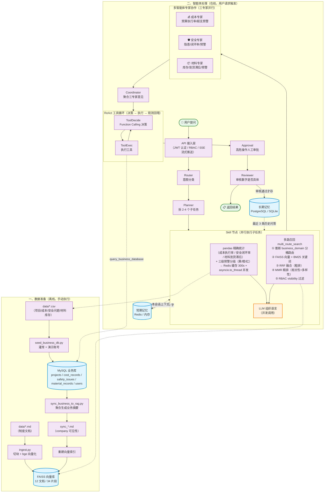

# 项目目录与文件说明（新手向）

> 这份文档逐个解释项目里每个目录、每个文件是干什么的。
> 阅读建议：先看「一、整体鸟瞰」和「二、完整流程图」建立全局认识，再看「五、一次请求的完整流转」理解请求链路，最后查具体文件。

---

## 一、整体鸟瞰

这是一个「智建 Agent · 工程多智能体分析平台」，用户用自然语言提问（如"分析 2026 年上半年项目成本"），系统经过 Router → Planner → Skill → Experts（三专家并行）→ Coordinator → ReAct 工具循环 → Reviewer 协作后给出带精确数字的回答。代码按职责分层：

```
用户/浏览器
   │  HTTP / SSE
   ▼
app/
├── api/            ← 接入层（FastAPI）：接收请求、推送流式结果、提供网页
├── agent/          ← 智能体编排层（LangGraph）：节点串成工作流
│   └── nodes/
│       ├── router.py      意图分类
│       ├── planner.py     拆分子任务
│       ├── skill.py       多路召回 + pandas 精确统计
│       ├── experts.py     多智能体专家协作（成本/安全/材料三专家并行）
│       ├── coordinator.py 协调者（聚合三专家意见）
│       ├── tool_decide.py ReAct 决策（Function Calling）
│       ├── tool_exec.py   ReAct 执行
│       ├── approval.py    高危操作人工审批
│       ├── reviewer.py    审核
│       └── text2sql.py    Text-to-SQL
├── client/         ← Redis 短期记忆 + 缓存 + 分布式锁 + 向量库客户端
├── repository/     ← 数据库连接与查询（业务库 / 用户 / 长期记忆）
├── model/          ← ORM 模型（SQLAlchemy 表映射，DB 持久化层）
├── entity/         ← 业务实体（Pydantic dataclass，脱离 ORM 的领域数据载体）
├── mapper/         ← 转换器（ORM Model ↔ Entity，解耦持久化层与业务层）
├── service/        ← RBAC 数据权限 + 外部数据采集
├── mcp/            ← MCP 工具总线（将外部能力标准化暴露为 MCP Server）
│   ├── server.py    mcp-mysql / mcp-vector / mcp-erp 三类工具
│   └── client.py    MCP 客户端适配器（桥接 LangChain Tool）
├── conf/           ← 配置中心
├── script/         ← 离线脚本（数据生成/入库/种子/同步）
└── utils/          ← 通用工具（日志等）

data/               ← 工程项目数据（项目/成本/安全问题 CSV + 制度文档）
```

---

## 二、完整流程图

下图把项目分成**离线数据准备**和**在线智能体处理**两个阶段，建议先看懂这张图再读后面的文件说明。

> 📌 **查看流程图**：TRAE CN 的 Markdown 预览不支持 Mermaid 渲染，请用浏览器打开 [architecture.html](file:///c:/Users/admin/PycharmProjects/PythonProject2/docs/architecture.html) 查看渲染后的彩色流程图。
> 下方折叠的 Mermaid 源码在 GitHub 等支持 Mermaid 的平台会自动渲染。

<details>
<summary>📜 点击展开 Mermaid 源码</summary>



</details>

**颜色说明**：🟦 数据库/存储 | 🟧 LLM 调用 | 🟪 智能体节点 | 🟩 输入输出

---

## 三、根目录文件（配置与入口）

| 文件 | 类型 | 作用 |
|------|------|------|
| `main.py` | 源码 | **项目启动入口**。`python main.py` 即启动服务，监听 8000 端口 |
| `requirements.txt` | 文本 | Python 依赖清单及版本，`pip install -r requirements.txt` 安装 |
| `.env.example` | 文本 | 环境变量模板（**可以提交**，不含真实密钥）。复制为 `.env` 后填入真实 Key |
| `.env` | 文本（本地私有） | 真实配置，含 API Key，**已被 gitignore，绝不能提交** |
| `.gitignore` | 文本 | 声明哪些文件不进 Git（`.env`、`.venv`、缓存、数据库文件等） |
| `.dockerignore` | 文本 | 构建 Docker 镜像时排除哪些文件（类似 .gitignore） |
| `ruff.toml` | 文本 | 代码检查工具 ruff 的规则配置（CI 会用它检查代码风格） |
| `Dockerfile` | 文本 | 描述如何把本项目打包成 Docker 镜像 |
| `docker-compose.yml` | 文本 | 一键编排 API + Redis + PostgreSQL + Qdrant + 初始化容器 |
| `start.bat` | 文本 | Windows 一键启动本地 Redis 与服务 |
| `README.md` | 文本 | 项目门面文档（架构、启动方式、API、评测、截图） |
| `LICENSE` | 文本 | MIT 开源协议 |

---

## 四、各目录详解

### 📁 app/api/ —— 接入层

| 文件 | 作用 |
|------|------|
| `app/api/main.py` | **唯一的后端入口**，FastAPI 应用全部在这里：<br>• `POST /chat` 一次性回答接口（带限流、可选 API Key 鉴权）<br>• `POST /chat/stream` SSE 流式接口，逐节点推送"AI 思考过程"<br>• `POST /chat/approve` 人工审批恢复<br>• `GET /ui` 内嵌的网页（一大段 HTML/CSS/JS 写在这个文件里）<br>• `GET /health` 健康检查、`GET /metrics` 运行指标 |
| `app/api/auth.py` | JWT 签发与 `get_current_user` 依赖：身份以 token 为准，请求体 user_id 无法伪造 |

### 📁 app/agent/ —— 智能体编排层（项目核心）

| 文件 | 作用 |
|------|------|
| `app/agent/state.py` | 定义 `AgentState`——节点之间传递的**共享数据结构**（用户输入、任务类型、计划、工具结果、审核结论等） |
| `app/agent/service.py` | **工作流装配图**：定义节点顺序与条件跳转（ReAct 循环、审核不通过打回 planner，最多 3 次）；同时给每个节点包了耗时统计 |
| `app/agent/llm.py` | LLM 客户端单例 + 安全调用函数：`safe_invoke`（指数退避重试、失败兜底、token 记账）、`safe_ainvoke_with_tools`（原生 Function Calling） |
| `app/agent/metrics.py` | 进程内指标聚合器：请求数、LLM 调用、token 用量、节点延迟、工具调用次数，供 `/metrics` 读取 |
| `app/agent/nodes/router.py` | **节点1 路由分类器**：判断问题属于数据分析 / 报告生成 / 知识问答哪一类，输出有枚举校验 |
| `app/agent/nodes/planner.py` | **节点2 规划器**：把复杂问题拆成 2-4 个具体可执行的子任务（JSON 列表，带解析兜底） |
| `app/agent/nodes/skill.py` | **节点3 技能执行器（干活主力）**：遍历每个子任务——① `multi_route_search()` 多路召回知识库片段（分桶路由 + 向量/关键词混合检索 + RRF 融合 + MMR 精排，带 RBAC 过滤）；② 用 pandas 从 CSV **预计算精确统计数字**（成本执行率 / 安全闭环率 / 材料到货滞后，均带三级预警分级：黄/橙/红），统计结果走 **Redis 缓存（TTL 300s）**，三域统计用 `asyncio.to_thread` + `gather` 并发执行避免阻塞事件循环；③ 并发调用 LLM 组织语言，给出初步分析 |
| `app/agent/nodes/experts.py` | **节点4 多智能体专家协作**：成本 / 安全 / 材料三个领域专家，各有独立角色 prompt，只看自己领域的统计数据，从专业视角补充 Skill 的初步分析；三专家用 `asyncio.gather` 并行调用 LLM，延迟 ≈ 1 次调用 |
| `app/agent/nodes/coordinator.py` | **节点5 协调者**：聚合三专家的专业分析，融合成连贯的综合回答（保留关键数字和预警等级，指出跨域关联），结果写回 `tool_result` 供后续 ReAct / Reviewer 使用 |
| `app/agent/nodes/tool_decide.py` | **ReAct 决策**：用 DeepSeek 原生 Function Calling 决定调用哪个工具；含"趋势图/折线"关键词的确定性前置规则；达到最大轮数强制熔断 |
| `app/agent/nodes/tool_exec.py` | **ReAct 执行**：执行工具并把观测结果回喂下一轮决策 |
| `app/agent/nodes/tool.py` | 工具注册表（`@tool`：查库 / 成本统计 / 安全统计 / 读文件 / 画图），逐个工具做数据出口权限判定 |
| `app/agent/nodes/text2sql.py` | Text-to-SQL：生成 SQL + 只读防护 + 越权校验 + 报错自愈重试 |
| `app/agent/nodes/approval.py` | HITL：`interrupt()` 挂起高危工具调用，等待 `POST /chat/approve` 恢复 |
| `app/agent/nodes/reviewer.py` | 审核器：回答必须含具体数字、不能有空话，通过则输出最终答案并写入长期记忆 |

### 📁 app/client/ —— 外部客户端

| 文件 | 作用 |
|------|------|
| `app/client/short_term.py` | **短期记忆**：优先 Redis（会话上下文，1 小时 TTL）；Redis 连不上时自动降级为进程内字典 |
| `app/client/cache.py` | **Redis 缓存**：带 TTL 的键值缓存（默认 300s），Redis 不可达降级内存。用 `@cached` 装饰器缓存 pandas 统计结果，避免每次请求重读 CSV |
| `app/client/lock.py` | **分布式锁**：Redis SETNX + 唯一 token 校验 + 看门狗自动续期，释放时用 Lua 脚本原子校验 token 防止误删。Redis 不可达降级为进程内 `threading.Lock`。用于灌库、用户创建、长期记忆写入等临界区 |
| `app/client/vectorstore.py` | **向量库工厂 + 多路召回**：FAISS（默认本地）/ Qdrant（服务化，原生 metadata 过滤）；Qdrant 不可达自动降级 FAISS；`multi_route_search()` 实现分桶路由（按 business_domain：cost/safety/quality/technical/management/material/weather）+ dense/sparse 混合检索（FAISS + BM25）+ RRF 融合（粗排）+ MMR 精排（相关性与多样性平衡） |
| `app/client/__init__.py` | 包标记文件 |

### 📁 app/conf/ —— 配置层

| 文件 | 作用 |
|------|------|
| `app/conf/config.py` | **统一配置中心**。所有环境变量（API Key、模型名、Redis 地址、限流阈值等）都在这里读取，其他文件只从这里 import |

### 📁 app/model/ —— 模型层（ORM 表映射，DB 持久化层）

| 文件 | 作用 |
|------|------|
| `app/model/base.py` | SQLAlchemy `declarative_base()`，用户与业务表的 ORM 模型共用 |
| `app/model/user.py` | `users` 表结构 + 角色常量（admin / manager / viewer） |
| `app/model/business.py` | `projects` / `cost_records` / `safety_issues` / `material_records` 表结构 |

### 📁 app/entity/ —— 业务实体层（Pydantic dataclass，脱离 ORM）

与 model 层的区别：model 是 ORM 模型（与数据库表绑定），entity 是业务领域的数据载体（不依赖数据库框架）。业务层只依赖 entity，不直接耦合 ORM。

| 文件 | 作用 |
|------|------|
| `app/entity/project_entity.py` | `ProjectEntity`：工程项目业务实体 |
| `app/entity/cost_record_entity.py` | `CostRecordEntity`：成本流水业务实体 |
| `app/entity/safety_issue_entity.py` | `SafetyIssueEntity`：质量安全问题业务实体 |
| `app/entity/material_record_entity.py` | `MaterialRecordEntity`：材料库存业务实体 |
| `app/entity/user_entity.py` | `UserEntity`：用户业务实体 |

### 📁 app/mapper/ —— 转换层（ORM Model ↔ Entity）

负责 ORM 模型与业务实体之间的双向转换，解耦持久化层与业务层。

| 文件 | 作用 |
|------|------|
| `app/mapper/project_mapper.py` | `ProjectMapper`：`to_entity(model)` / `to_model(entity)` |
| `app/mapper/cost_record_mapper.py` | `CostRecordMapper`：成本流水 Model ↔ Entity 转换 |
| `app/mapper/safety_issue_mapper.py` | `SafetyIssueMapper`：质量安全问题 Model ↔ Entity 转换 |
| `app/mapper/material_record_mapper.py` | `MaterialRecordMapper`：材料库存 Model ↔ Entity 转换 |
| `app/mapper/user_mapper.py` | `UserMapper`：用户 Model ↔ Entity 转换 |

### 📁 app/repository/ —— 仓储层

| 文件 | 作用 |
|------|------|
| `app/repository/business.py` | 业务库引擎/会话、schema 自然语言描述、只读 SQL 校验与执行 |
| `app/repository/users.py` | 用户认证与创建（内部用 mapper 把 ORM 转 Entity，避免暴露 password_hash） |
| `app/repository/long_term.py` | **长期记忆**：把审核通过的问答存入 PostgreSQL/SQLite（`DATABASE_URL`），不可达时自动跳过 |

### 📁 app/service/ —— 服务层

| 文件 | 作用 |
|------|------|
| `app/service/permission.py` | **RBAC 数据权限**：`scoped_region` / `sql_within_scope` / `rag_scope_filter`，所有数据出口共用同一判定 |
| `app/service/collect.py` | 外部数据源采集：简单工厂 + 6 小时增量缓存 + 单源失败降级 |

### 📁 app/mcp/ —— MCP 工具总线层

将所有外部能力以 MCP Server 形式标准化暴露，Agent 可通过统一的 `tool_call` 接口调用，实现解耦与可替换。当前 demo 中 LangChain Function Calling 链路继续工作，本层作为"能力标准化出口"并行存在。

| 文件 | 作用 |
|------|------|
| `app/mcp/server.py` | **MCP 工具总线 Server**（MCPServer），暴露三类工具：<br/>• `mcp-mysql-server`：`mysql_query`（只读 SQL + RBAC 区域过滤）/ `mysql_query_materials` / `get_db_schema`<br/>• `mcp-vector-server`：`vector_search`（多路召回 + RRF + MMR）<br/>• `mcp-erp-server`：`erp_fetch_purchase_orders` / `erp_fetch_inventory` / `erp_fetch_schedule`（模拟外部 ERP） |
| `app/mcp/client.py` | **MCP 客户端适配器**：将 MCP 工具桥接为 LangChain `StructuredTool`，`get_mcp_tools()` 返回可直接注册到 Agent 的工具列表。`config.ENABLE_MCP_TOOLS=true` 时自动追加到 `_TOOLS`，Agent 即可通过 MCP 协议调用工具。 |

### 📁 app/script/ —— 离线脚本层

| 文件 | 作用 |
|------|------|
| `app/script/generate_demo_data.py` | **演示数据生成脚本**：生成 20 个项目、784 条成本（12 个月）、88 条安全问题、76 条材料库存（10 类材料）的 CSV（固定随机种子可复现），扩充业务数据规模 |
| `app/script/ingest.py` | **知识库入库脚本**：读取 data/ 文档 → 切块 → bge-small-zh 向量化 → 写入 FAISS/Qdrant；`_infer_metadata()` 推断 `business_domain` / `doc_type` / `time_period` / `visibility` 四维元数据（供分桶路由与 RBAC 过滤）。更新知识库后重跑 |
| `app/script/seed_business_db.py` | 业务库种子脚本（灌项目/成本/安全问题/材料库存 + 三个演示账号，并清理旧销售域遗留表） |
| `app/script/sync_business_to_rag.py` | 业务库 → 成本/安全摘要 Markdown → 重建向量索引 |
| `app/script/demo_tool_permissions.py` | 一键演示 RBAC 在各数据出口的拦截效果 |

### 📁 app/utils/ —— 通用工具

| 文件 | 作用 |
|------|------|
| `app/utils/logging_config.py` | structlog 结构化日志配置（控制台彩色 / JSON 两种格式，request_id 贯穿链路） |

### 📁 data/ —— 业务数据（RAG 的知识来源 + 统计的原始数据）

| 文件 | 作用 |
|------|------|
| `projects.csv` | 20 个工程项目（编号/名称/区域/项目经理/状态/合同额），覆盖 6 大区域，Text-to-SQL 的项目主数据 |
| `cost_records.csv` | 784 条项目成本流水（20 项目 × 12 月份 × 4 成本类别，竣工/停工项目按实际工期截断），pandas 统计与预算执行率的数据源 |
| `safety_issues.csv` | 88 条质量安全问题（类型/严重程度/整改状态/发现与闭环日期） |
| `material_records.csv` | 76 条材料库存记录（10 类材料/12 家供应商，含库存数量/预计到货日期/计划使用日期），到货滞后由 `eta_date > plan_use_date` 判定，pandas 统计的材料预警数据源 |
| `施工技术管理制度.md` | 技术交底、测量复核、隐蔽验收、雨季施工等制度，供知识问答检索 |
| `质量安全整改管理办法.md` | 隐患分级、整改期限、闭环管理要求 |
| `项目成本管理办法.md` | 成本职责、月度分析、偏差分级管控与预警 |
| `钢筋工程作业指导书.md` | 钢筋进场检验、加工安装、隐蔽验收与常见质量问题 |
| `宝冶项目周报样例.md` | 工程项目周报样例（进度/成本/质量安全），业务原型示意数据 |
| `合同管理办法.md` | 合同分类权限、订立、履行、变更解除、归档（business_domain=management） |
| `施工现场临时用电安全技术规范.md` | 临时用电组织设计、配电线路、配电箱、接地防雷（business_domain=safety） |
| `混凝土结构工程施工质量验收规范.md` | 模板/钢筋/混凝土分项工程质量验收（business_domain=quality） |
| `工程项目进度管理办法.md` | 进度计划编制、执行、检查纠偏、变更管理（business_domain=management） |
| `建筑施工高处作业安全技术规范.md` | 临边洞口、攀登悬空、操作平台防护要求（business_domain=safety） |
| `sync_cost_summary.md` | ⚙️ 由 `sync_business_to_rag.py` 自动生成的集团成本摘要（company 可见性） |
| `sync_safety_summary.md` | ⚙️ 自动生成的质量安全问题摘要（company 可见性） |
| `business.db` | ⚙️ **运行时自动生成的业务库 SQLite（二进制）**，不是源码，已 gitignore |
| `long_term_memory.db` | ⚙️ **运行时自动生成的长期记忆 SQLite（二进制）**，已 gitignore |
| `.collect_state.json` | ⚙️ 数据采集增量缓存状态（自动生成） |

### 📁 evals/ —— 效果评测

| 文件 | 作用 |
|------|------|
| `evals/dataset.jsonl` | 20 道带标准答案的评测题（每行一题，答案关键词锚定真实数字） |
| `evals/run_eval.py` | 评测脚本：真实跑一遍全部题目，按关键词匹配 + 可选 LLM-as-judge 判分，`--gate` 可作 CI 门禁 |
| `evals/report.json` | ⚙️ 运行评测后**自动生成的报告**，已 gitignore |

### 📁 tests/ —— 自动化测试

| 文件 | 作用 |
|------|------|
| `tests/test_smoke.py` | 逐节点 + 全链路冒烟测试，mock 掉所有外部依赖（不调真实 LLM、不需要 Redis/索引） |
| `tests/test_auth_rbac.py` | JWT 签发/篡改/过期、密码哈希、RBAC 作用域、向量库降级 |
| `tests/test_text2sql.py` | 只读 SQL 防护、SQL 提取、临时 SQLite 真执行 |

### 📁 docs/ —— 文档与图片

| 文件 | 作用 |
|------|------|
| `docs/architecture.html` | 项目架构流程图（浏览器打开可看 Mermaid 渲染后的彩色图） |
| `docs/screenshot.png` | README 里展示的 Web UI 真实运行截图 |
| `docs/OPTIMIZATION.md` | 个人复盘文档（优化记录），**仅本地保留，已 gitignore** |
| `docs/PROJECT_STRUCTURE.md` | 你正在看的这份文件（本地学习用） |

### 📁 .github/workflows/ —— CI 自动化

| 文件 | 作用 |
|------|------|
| `.github/workflows/ci.yml` | 每次 push / PR 自动执行 `ruff check` + `pytest`；配置 secret 后可跑评测门禁 |

---

## 五、一次请求的完整流转（把文件串起来）

以"分析 2026 年上半年项目成本，画个趋势图"为例：

1. **浏览器** → 打开 `app/api/main.py` 提供的 `/ui` 页面，点发送
2. **`app/api/main.py`** → 限流检查 → 调用 `app/agent/service.py` 装配的工作流，通过 SSE 把每个节点的产出实时推回浏览器
3. **`nodes/router.py`** → 判定为"数据分析"类
4. **`nodes/planner.py`** → 拆成 ["统计项目总成本", "分区域/成本类别分布", "画月度成本趋势图"]
5. **`nodes/skill.py`** → 逐个处理：
   - 数字类：pandas 读 `data/cost_records.csv`、`data/safety_issues.csv`、`data/material_records.csv` 精确计算（预算执行率、闭环率、材料到货滞后率等，并按阈值标注黄/橙/红三级预警）
   - 知识类：`app/client/vectorstore.py` 的 `multi_route_search()` 多路召回——先推断 `business_domain` 分桶路由，再 FAISS 向量 + BM25 关键词混合检索，RRF 融合（粗排）后经 MMR 精排（平衡相关性与多样性），最后应用 RBAC 过滤
   - 同时从 `app/client/short_term.py` 取本会话历史上下文
   - 产出**初步分析结果**
6. **`nodes/experts.py`** → 多智能体专家协作：成本 / 安全 / 材料三个领域专家并行（`asyncio.gather`），各用独立角色 prompt 从专业视角深化初步分析，输出 `expert_analyses`
7. **`nodes/coordinator.py`** → 协调者聚合三专家意见，融合成综合回答（保留预警等级、指出跨域关联），写回 `tool_result`
8. **`nodes/tool_decide.py` → `nodes/tool_exec.py`** → 命中"趋势图"关键词直接绘图；需要事实数据时经 Function Calling 调 `text2sql` 查业务库，结果回喂再决策
9. **`nodes/approval.py`** → 高危工具（业务库查询）在 `APPROVAL_MODE=true` 时挂起等待人工审批
10. **`nodes/reviewer.py`** → 审核数字是否具体、有无空话；通过则输出最终答案，并经 `app/repository/long_term.py` 存入数据库
11. **`app/api/main.py`** → 最终回答推给浏览器渲染；全程 token/耗时被 `app/agent/metrics.py` 记录，可在 `/metrics` 查看

配置贯穿全程：`app/conf/config.py` 提供所有参数，`app/agent/llm.py` 统一负责与 DeepSeek 通信。

---

## 六、文件分类速查

### 需要人写/改的源码（面试讲的就是这些）
```
main.py
app/conf/config.py
app/api/main.py  app/api/auth.py
app/agent/*.py  app/agent/nodes/*.py
app/client/*.py  app/repository/*.py  app/model/*.py  app/entity/*.py  app/mapper/*.py  app/service/*.py  app/mcp/*.py
app/script/*.py
evals/run_eval.py  tests/*.py
```

### 需要人维护的数据与文本
```
data/*.csv、data/*.md    evals/dataset.jsonl
README.md  .env.example  docker-compose.yml  Dockerfile  ruff.toml
```

### ⚙️ 工具自动生成的（不要手动打开/编辑，删了也能再生成）
| 路径 | 谁生成的 | 删了怎么恢复 |
|------|----------|-------------|
| `__pycache__/`、`*.pyc` | Python 运行时 | 再运行一次自动生成 |
| `.ruff_cache/` | ruff 检查时 | 再跑一次 ruff |
| `.pytest_cache/` | pytest 运行时 | 再跑一次测试 |
| `faiss_index/`（index.faiss + index.pkl） | `python app/script/ingest.py` | 重跑入库脚本 |
| `dump.rdb` | Redis 持久化文件 | 重启 Redis |
| `data/business.db` | 业务库引擎初始化 / 种子脚本 | 重跑 `app/script/seed_business_db.py` |
| `data/long_term_memory.db` | 程序首次写长期记忆时 | 自动重建（历史数据会丢） |
| `data/.collect_state.json` | 数据采集脚本 | 自动重建 |
| `evals/report.json` | 跑评测脚本 | 重跑评测 |
| `.venv/` | 你创建虚拟环境时 | `python -m venv .venv` + 重装依赖 |
| `.idea/` | PyCharm/IDE 的个人配置 | IDE 自动重建 |

> 记忆技巧：**扩展名是 `.py/.json/.csv/.md/.yml/.toml/.txt/.bat/.example` 的基本都是文本能打开；`.pyc/.faiss/.pkl/.db/.rdb/.png` 基本都是二进制要程序读。**

---

## 七、新人上手顺序建议

1. `main.py` → 知道怎么启动
2. `app/api/main.py` → 看请求从哪进来（先只看路由定义，HTML 部分可跳过）
3. `app/agent/state.py` → 看节点之间传什么数据
4. `app/agent/service.py` → 看节点怎么连起来
5. 按 router → planner → skill → tool_decide / tool_exec → reviewer 顺序读 `app/agent/nodes/`
6. 最后看 `app/client/`、`app/repository/` 和 `app/script/ingest.py` 这些辅助模块
